<p align="center">
  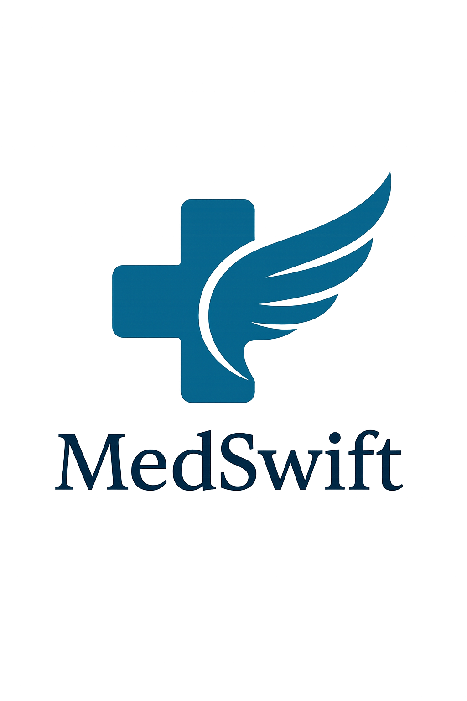
</p>

<h1 align="center">MedSwift: Biomedical Knowledge Extraction using LLMs</h1>

<p align="center">
  LLM-powered <b>Named Entity Recognition (NER)</b> for unstructured patient reports, with a <b>doctor-in-the-loop</b> patient chatbot.
</p>

<p align="center">
  
  
  
  
  
  
  
</p>

---

## 📌 Overview

Hospitals hold critical information inside free-text PDF reports. MedSwift turns those reports into **structured patient records** and gives patients a **safe way to ask medical questions**.

- 📄 **PDF → structured record.** An LLM extracts 15 clinical entities from an uploaded report: name, age, gender, vitals, chief complaint, duration, surgical and family history, allergies and medications.
- 🗂️ **Patient registry.** New patients get a unique ID (`P001`, `P002`, …). Records can be searched and exported as a PDF report.
- 💬 **Doctor-approved chatbot.** A patient's question gets an LLM-drafted answer, but **the patient only sees it after a doctor approves it**.
- 📑 **Report Q&A chatbot.** Patients can upload their own report and ask questions about it.
- 👥 **Role-based access** for Admin, Doctor and Patient.

## 🏗️ Architecture

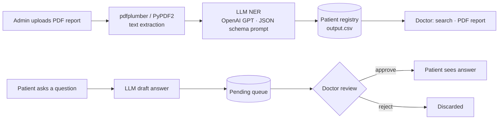

| Role | Features |
|---|---|
| **Admin** | New patient entry (form) · New patient entry via PDF report (LLM extraction) · Search old patients |
| **Doctor** | Search patient records · Generate a downloadable PDF report · Approve or reject chatbot answers |
| **Patient** | Ask a medical question · View doctor-approved answers · Chat with an uploaded report |

---

## 📸 Screenshots

| Login | Invalid login |
|---|---|
| 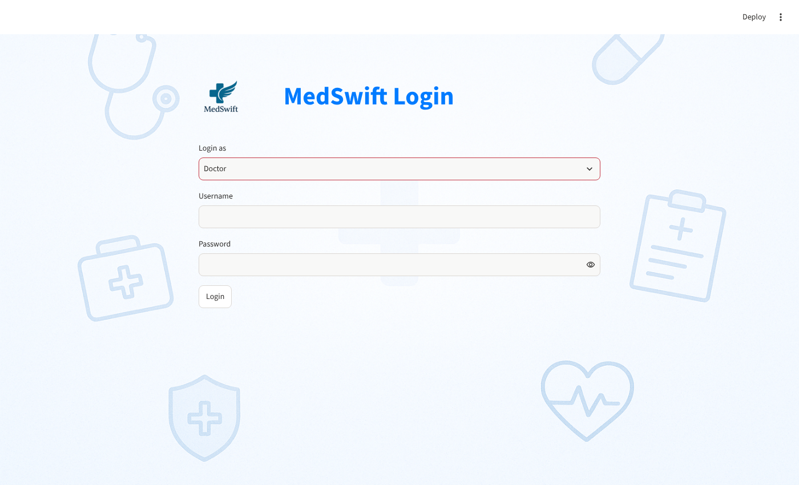 | 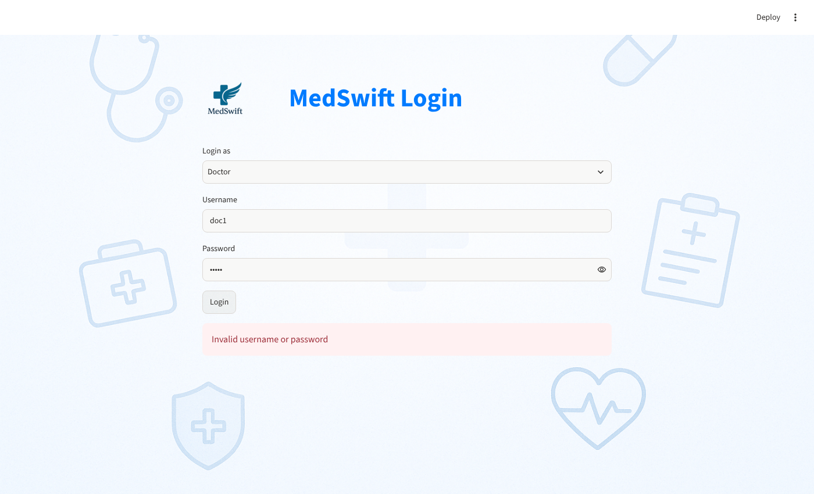 |

| Doctor dashboard | Patient record search |
|---|---|
| 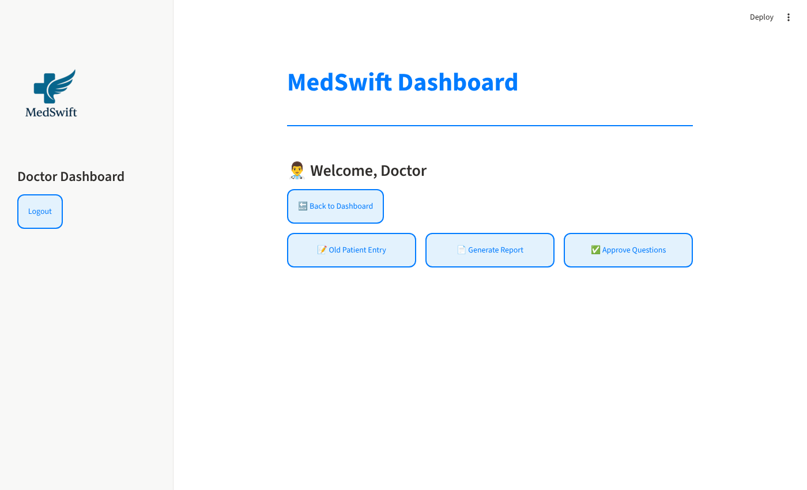 | 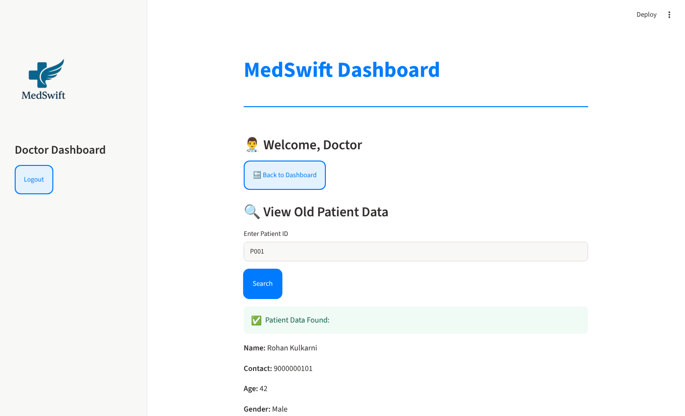 |

| Doctor approval panel | Patient sees approved answers |
|---|---|
| 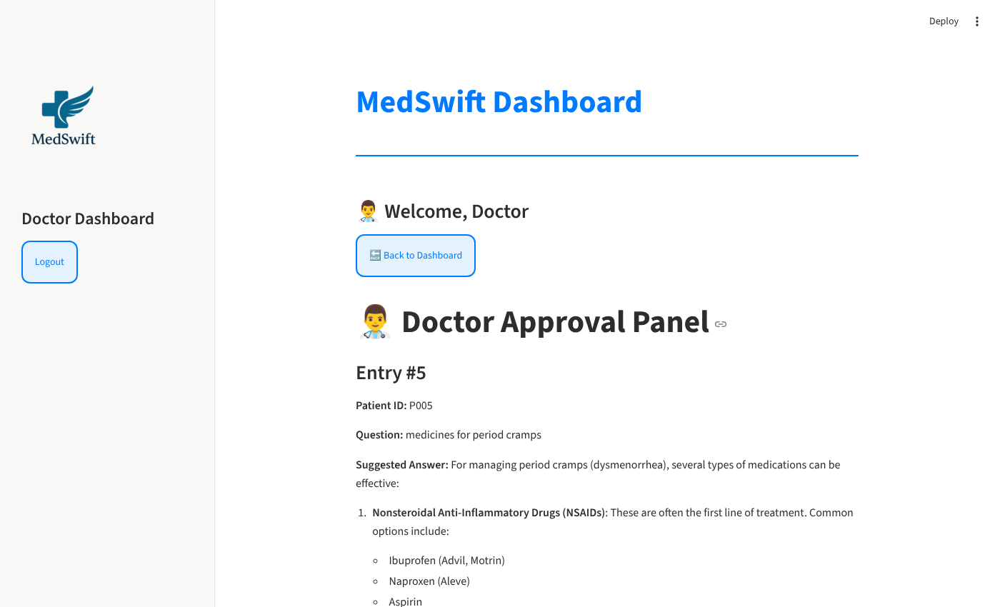 | 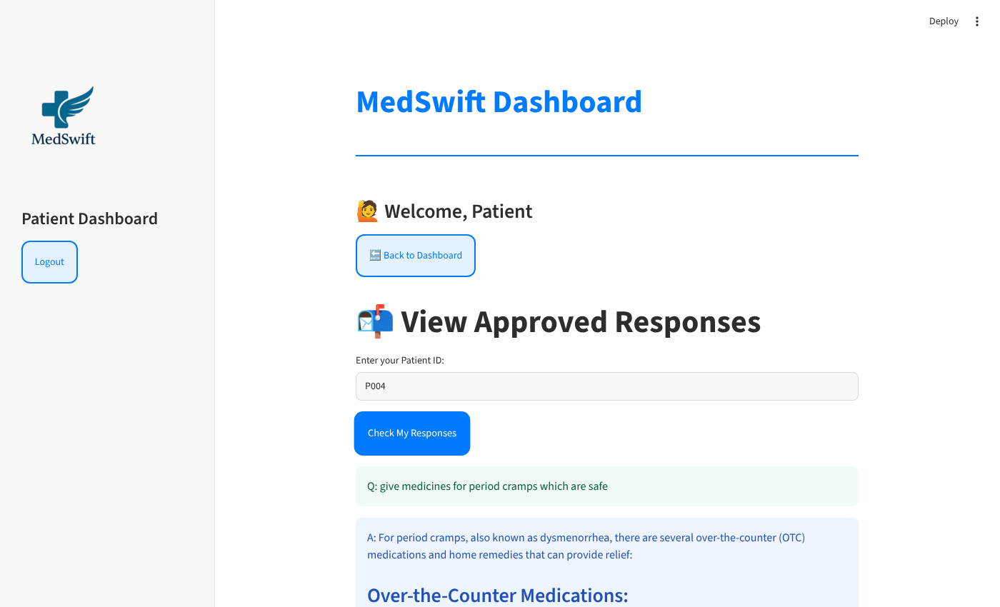 |

| Admin: new patient form | Admin: PDF report upload and text extraction |
|---|---|
| 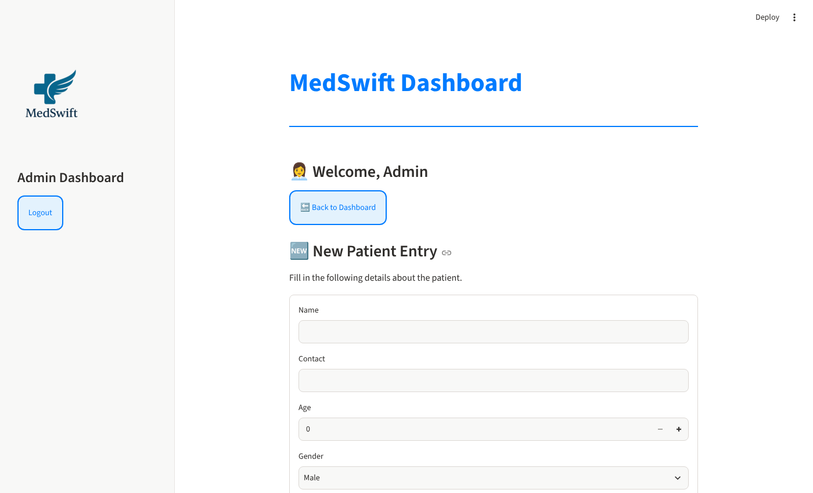 | 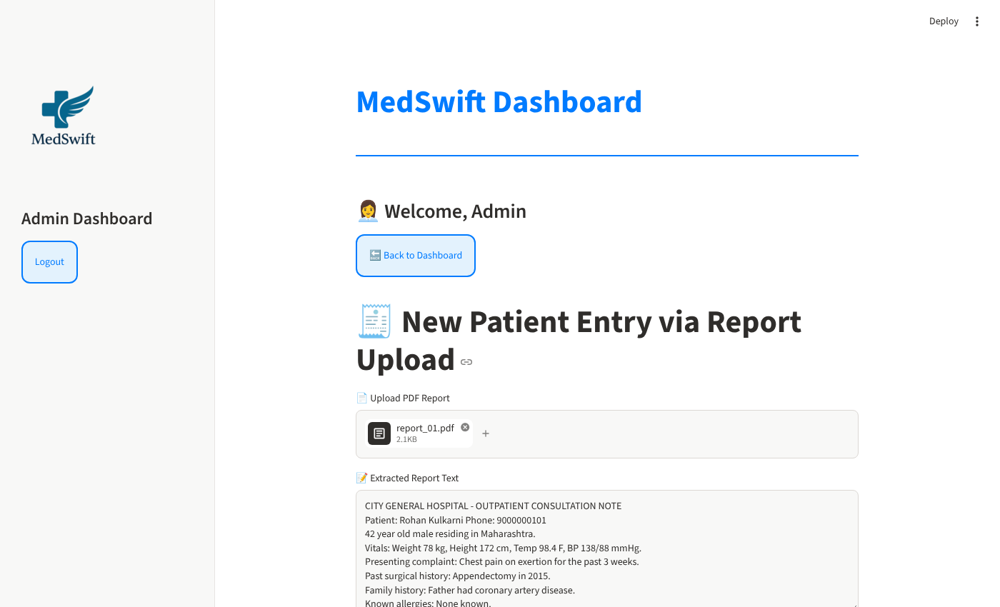 |

---

## 🚀 Getting started

```bash
git clone https://github.com/ChetanyaB/Biomedical-Knowledge-Extraction-Using-LLM.git
cd Biomedical-Knowledge-Extraction-Using-LLM
python -m venv venv                # create a virtual environment
venv/Scripts/activate              # Windows
# source venv/bin/activate         # Linux / macOS
pip install -r requirements.txt

cp .env.example .env        # then add your OPENAI_API_KEY (and GROQ_API_KEY if used)
streamlit run application.py
```

**Demo logins**

| Role | Username | Password |
|---|---|---|
| Admin | `admin` | `admin@pass` |
| Doctor | `doc1` | `doc@pass` |
| Patient | `pat1` | `pat@pass` |

The app starts without API keys. Only the LLM features (report extraction and chatbots) need `OPENAI_API_KEY`.

## 🗂️ Project structure

```
├── application.py          # Streamlit UI: login + Admin / Doctor / Patient dashboards
├── features.py             # Extraction, registry, PDF reports, chatbots, approval queue
├── output.csv              # Patient registry
├── pending_chats.json      # Chatbot answers waiting for doctor approval
├── faiss_index/            # Vector store for the RAG chatbot
├── eval/
│   ├── make_sample_reports.py   # Builds 10 fictional labelled reports
│   ├── sample_reports/          # The generated PDFs
│   ├── ground_truth.json        # Gold labels (15 fields × 10 reports)
│   └── evaluate.py              # Field-level Precision / Recall / F1
├── tests/test_medswift.py  # 16 automated test cases
└── docs/screenshots/
```

---

## ✅ Test case scenarios

Run with `pytest -v`. 

| # | Scenario | Expected result | Status |
|---|---|---|---|
| TC01 | App starts with **no API keys** set | Imports cleanly; data path is portable | ✅ Pass |
| TC02 | LLM feature used without a key | Clear "set OPENAI_API_KEY" error | ✅ Pass |
| TC03 | Valid login as Doctor / Patient / Admin (3 cases) | Correct dashboard opens | ✅ Pass |
| TC04 | Wrong password | "Invalid username or password" | ✅ Pass |
| TC05 | Patient credentials on the Admin tab | Login refused | ✅ Pass |
| TC06 | New patient ID generation | Unique ID (`P007`), never a duplicate | ✅ Pass |
| TC07 | Save a patient, then search by ID (with spaces) | Record found | ✅ Pass |
| TC08 | Search for an unknown ID | "No patient found" | ✅ Pass |
| TC09 | Generate a patient report | Valid PDF bytes | ✅ Pass |
| TC10 | Extract text from an uploaded PDF | Name and vitals present in the text | ✅ Pass |
| TC11 | LLM returns valid JSON | All 15 fields parsed | ✅ Pass |
| TC12 | LLM wraps JSON in a ```` ```json ```` fence | Still parsed | ✅ Pass |
| TC13 | LLM returns plain `Key: value` text | Fallback parser recovers the fields | ✅ Pass |
| TC14 | Evaluation metric sanity check | Perfect = 1.0 F1, empty = 0 recall | ✅ Pass |

Full output: [`docs/test_results.txt`](docs/test_results.txt).

## 📊 Evaluation

**Task:** extract 15 entities from each of 10 free-text patient reports (150 labelled fields). The reports are fictional and were generated by `eval/make_sample_reports.py`.

**Metric:** field-level **Precision, Recall and F1**. A prediction counts as correct when its token overlap with the gold value has F1 ≥ 0.8. This tolerates harmless differences such as `"42"` vs `"42 years"`.

| | Definition |
|---|---|
| Precision | correct fields ÷ fields the model filled |
| Recall | correct fields ÷ fields present in the report |
| F1 | harmonic mean of the two |
| Document accuracy | reports with **all 15** fields correct |

**Run it** (requires an API key):

```bash
python eval/evaluate.py                                   # gpt-4o-mini (the app's default)
python eval/evaluate.py --model gpt-4.1-mini
python eval/evaluate.py --provider groq --model llama-3.1-8b-instant
```

The script writes the per-field table to `eval/results.md` and a chart to `docs/screenshots/evaluation.png`.

<!-- EVAL_RESULTS_START -->
### Results: `gpt-4o-mini` (10 reports, 150 fields)

| Metric | Score |
|---|---|
| **Micro Precision** | **1.00** |
| **Micro Recall** | **1.00** |
| **Micro F1** | **1.00** |
| Fields extracted correctly | 150 / 150 |
| Per-field F1 (all 15 fields) | 1.00 |

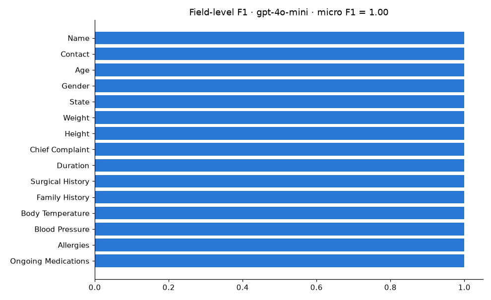

**How to read this:** the LLM extraction prompt is reliable on **clean, typed, English consultation notes**. It found every field even though each report is free text with no field labels (for example, *"42 year old male residing in Maharashtra"* gives Age, Gender and State). The test set is small and synthetic, so real-world accuracy will be lower on:
- scanned or handwritten reports, where OCR noise appears before the LLM sees the text,
- reports with missing, conflicting or abbreviated values (e.g. *"BP 138/88, T 37°C"*),
- non-English or mixed-language notes.

**Next step:** add de-identified real reports with harder cases to `eval/ground_truth.json` and re-run `python eval/evaluate.py`.
<!-- EVAL_RESULTS_END -->

---

## 🔒 Responsible-AI notes

- Every chatbot answer goes through **human (doctor) approval** before a patient sees it.
- Patient data stays in a local CSV. For production, use an encrypted database and anonymise records before sending text to an external LLM.
- MedSwift is an academic project and **not a medical device**.

## 🛠️ Tech stack

`Python` · `Streamlit` · `OpenAI GPT` · `Groq (Llama 3.1)` · `LangChain` · `FAISS` · `Google Generative AI Embeddings` · `pdfplumber` · `PyPDF2` · `ReportLab` · `Pandas` · `pytest`
